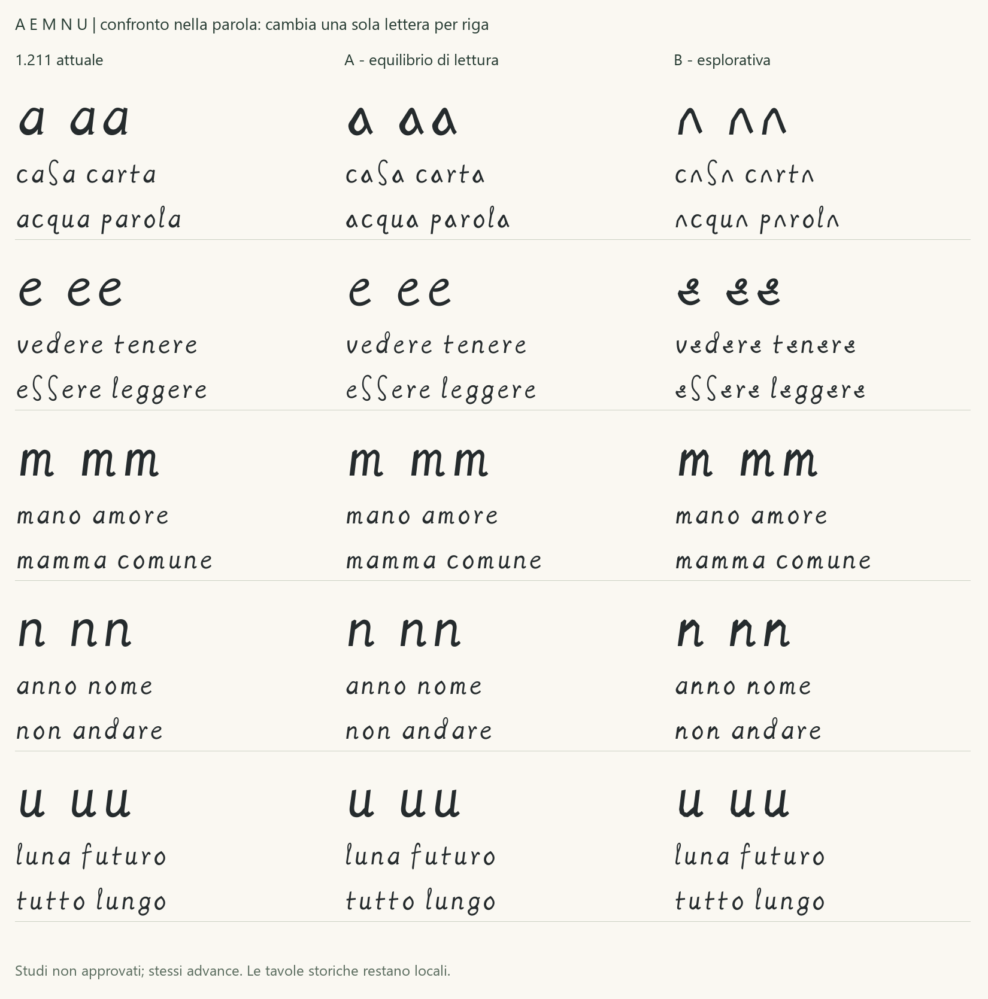

# Studio delle varianti a, e, m, n, u

**Esito successivo:** la [Regular 1.220](REGULAR_1_220.md) integra la
scelta umana **a A, e A, m B, n B, u B**. Il record seguente conserva
lo stato preparatorio: le dieci proposte e i limiti della ricerca restano
invariati. La nuova ricevuta registra la selezione separatamente.

15 ottobre 2026. Dieci proposte indipendenti confrontate con la Regular
1.211. La richiesta riguarda analisi storica, ricerca di campioni più
dettagliati e due varianti per lettera da valutare nelle parole.
La selezione umana resta da effettuare; nessuna proposta è integrata
nel font distribuito o installata. La Regular corrente resta 1.211.

## Materiale e ricerca del dettaglio

Sono riesaminate tutte le **27 localizzazioni con lettura revisionata**
già registrate per queste lettere: cinque a, sette e, cinque m, cinque n
e cinque u, BNE MSS/8937, folii 1r–4r. Originali verificati per SHA256,
ritagli e contesti ampliati reversibili; specchiatura orizzontale e
zoom nearest-neighbor senza ricostruzione o alterazione degli originali.
Le riserve sulle letture e sui confini restano valide. M08 e u08 non
sono riferimenti geometrici principali.

**Non sono acquisiti nuovi campioni con maggiore risoluzione effettiva.**
Il PDF ufficiale della pagina BNE 16 contiene un'immagine di 1579 × 2174
pixel, sostanzialmente equivalente al JPEG già disponibile di 1578 × 2174.
Non si presenta il pixel aggiuntivo in larghezza come un miglioramento.
I contesti più ampi chiariscono attacchi e vicini, senza aggiungere dettaglio
al segno. Le proposte rimangono limitate dalla qualità di queste immagini.

Il 15 ottobre il pannello ufficiale BNE della pagina 16 indica dominio
pubblico, CC BY 4.0 o equivalente, attribuzione BNE e uso gratuito senza
previa autorizzazione. La singola pagina PDF è acquisita soltanto nello
studio locale ignorato; nessuna riproduzione è aggiunta a Git.
Credito: **Imágenes procedentes de los fondos de la Biblioteca Nacional
de España**. Ritaglio, specchiatura e ingrandimento dichiarati; nessun avallo BNE.

È consultato [e-Leo, Madrid I 2r](https://www.leonardodigitale.com/sfoglia/madrid-I/0002-r/),
con facsimile e trascrizione editoriale; nessuna sua immagine è acquisita.
La consultazione non costituisce una nuova conferma del token completo.

La [scheda British Library di Arundel MS 263](https://searcharchives.bl.uk/catalog/040-002039546)
espone un [manifesto IIIF](https://bl.digirati.io/iiif/ark:/81055/vdc_100180783503.0x000001)
con primo canvas «ff. 14v-1r» di 8579 × 6250 pixel. È una pista concreta
per una successiva ricerca, non una misura di cinque lettere già individuate.
Il collegamento ai diritti nel manifesto rimanda attualmente a una pagina
generica di ricerca. Nessuna immagine Arundel è acquisita o utilizzata
per i disegni; non è inferita una licenza dalla sola disponibilità IIIF.
La BNE documenta inoltre [Second Canvas](https://www.bne.es/es/noticias/1031-los-tesoros-de-la-bne-como-nunca-antes-los-habias-visto)
come canale mobile ad alta risoluzione: nessun campione è acquisito da quel canale.

## Osservazione e disegno

| Lettera | Osservazione sui bersagli esistenti | A | B e limite |
|---|---|---|---|
| a | Nucleo spesso a capanna stretta, con fondo aperto e raccordi incerti. | Corpo triangolare con chiusura inferiore e controforma: compromesso moderno per riconoscibilità. | Capanna aperta, più distante dalla a corrente; forte rischio di lettura come n o segno a punta. |
| e | Piccolo elemento superiore, a volte separato nel raster, sopra un corpo obliquo basso. | Occhio piccolo e alto, corpo continuo e uscita distesa. | Uncino e occhio alti sopra una fascia obliqua: più caratterizzata ma meno immediata. La continuità è progettata. |
| m | Tre minimi, spalle diseguali e raccordi tesi. | Spalle appiattite e sfalsate, ritmo compatto. | Cuspidi e raccordi diagonali più netti; controllare la lettura delle doppie. |
| n | Due minimi, raccordo alto obliquo e picco destro. | Spalla obliqua contenuta, asta destra riconoscibile. | Spalla a tetto più evidente, distinta dalla valle bassa della u. |
| u | Due minimi con valle asimmetrica nei confronti u01/u05/u09. | Fondo meno rotondo e risalita diagonale. | Fondo angoloso e risalita tesa, senza usare la u08 dubbia come modello. |

Peso, proporzioni, chiusure, raccordi e terminali restano decisioni
contemporanee. I pixel disponibili non ricostruiscono pressione, ordine
dei tratti o un unico modello invariabile di ogni lettera.

Il [registro dello studio](../data/aemnu_variant_study_2026-10-15.json)
punta a ID, folii, hash, coordinate, esclusioni e dieci SVG. Il CSV storico
mantiene gli stessi byte, 144 campioni, 101 revisionati e 43 candidati.
Non cambiano le classificazioni delle 26 minuscole.

## Confronto nelle parole



Ogni riga confronta tre font in cui cambia **soltanto la lettera indicata**
e, quando presente, il suo composito accentato. Gli advance sono identici:
le differenze sono di disegno, con eventuale effetto sul bianco ottico.

- a: «casa carta», «acqua parola».
- e: «vedere tenere», «essere leggere».
- m: «mano amore», «mamma comune».
- n: «anno nome», «non andare».
- u: «luna futuro», «tutto lungo».

La pagina generata presenta le cinque righe, i ragionamenti e le tavole
storiche locali apribili. Corpo e testo sono modificabili. Il confronto
finale delle due serie complete serve a controllare il ritmo complessivo;
non sostituisce la scelta indipendente per lettera. Le parole sono esempi
moderni, non nuove trascrizioni certificate.

Il parere progettuale dell'agente propone **a A, e A, m B, n B, u B**
come combinazione da discutere: a/e A conservano maggiore riconoscibilità,
m/n/u B introducono angolosità senza perdere i rispettivi raccordi alti
o bassi. La a B aperta è presentata come esplorazione, con un rischio
sostanziale di lettura; e B merita un confronto attento ai corpi piccoli.
Questo parere non registra una scelta umana e non cambia il font corrente.

## Compilazione e verifiche

```powershell
python examples/aemnu_study.py --out build/aemnu-study
```

Per aggiungere le tavole locali usare `--originals` con la cartella dei
JPEG già acquisiti, nominati per SHA256. Il generatore verifica i byte
prima di scrivere esclusivamente derivati in una nuova cartella `build/`.
Nessun download è eseguito dallo script. Servire la radice del progetto
e aprire `/build/aemnu-study/index.html`; la consegna locale può usare
un'esportazione separata nella cartella `/study-aemnu/`.

Le due famiglie complete sono **Leonardus AEMNU A/B**, versione tecnica
1.212 di studio non approvato, con dieci ulteriori font di confronto
isolato. Restano in `build/`. Mantengono 119 codepoint e 121 glifi;
à/è/é/ù e ancore combinanti seguono le basi pertinenti. Altri contorni,
advance e checkpoint distribuiti sono conservati. Il manifesto rifiuta
riferimenti dubbi promossi a geometria principale e false approvazioni.

Due build per serie sono identiche. Audit e copertura riescono; tutte
le 2.704 coppie delle 52 lettere sono controllate per le due serie a
16/24/48/96/128 ppem e per i dieci font isolati a 128 ppem. Zero collisioni
nelle condizioni raster dichiarate, soglia 127; questo non certifica
uniformità ottica o leggibilità universale. Prove nelle parole a
12/18/36/72 pt, 96 DPI, con HarfBuzz e FreeType senza fallback.
Il [rapporto QA](QA_AEMNU_STUDY_2026-10-15.json) registra gli esiti finali.
