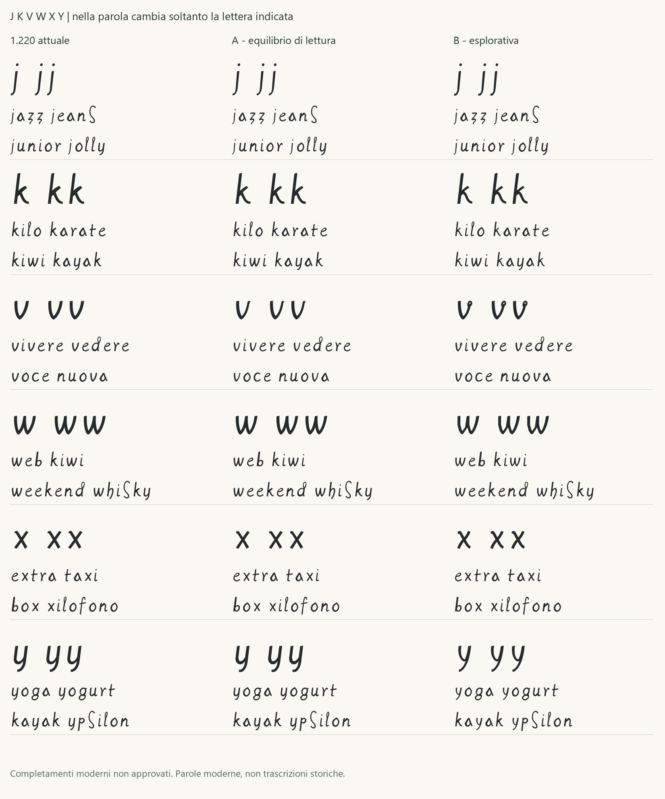

# Studio delle varianti j, k, v, w, x, y

**Esito successivo:** la [Regular 1.230](REGULAR_1_230.md) integra la
scelta umana **j A, k B, v B, w B, x B, y B**. Per v la lista esplicita
sceglie B, diversa dalla precedente preferenza dell'agente per A.
Il record seguente conserva lo stato preparatorio dello studio;
la [ricevuta](../data/human_jkvwxy_integration_review_2026-10-16.json)
registra separatamente l'adozione dei disegni, senza nuove letture storiche.

16 ottobre 2026. Dodici proposte indipendenti, due per lettera,
confrontate con la Regular **1.220**. Sono studi di completamenti
contemporanei: non aggiungono sei letture storiche confermate.
Nessuna variante è ancora selezionata, integrata o installata.
La versione corrente conserva gli stessi byte e la stessa famiglia.

## Materiale riesaminato

Il [manifesto](../data/jkvwxy_variant_study_2026-10-16.json) vincola il
font di partenza, il CSV delle evidenze, la valutazione precedente,
le localizzazioni e i dodici SVG originali. Sono riesaminate tutte le
sei candidate già registrate per j/v/x/y e le tre osservazioni K,
che restano escluse dalle evidenze di k minuscola.

| Lettera | Riferimenti esistenti | Limite conservato |
|---|---|---|
| j | `BNE_MI_SEARCH_303_J_01`, folio di lavoro 153v, viewer BNE 303 | Segno nel quarto peso circolare del ventaglio: j/i lunga/indice non risolto. Cerchio e raggi esclusi. |
| k | Tre contesti K, folii di lavoro 2v e 5r, viewer 17 e 22 | Asta e due bracci osservabili; non attestazione di k minuscola. |
| v | `BNE_MI_SEARCH_049_V_01` e `V_02`, 18v, viewer 49 | Piccolo ritorno ovale; associazione v/u/o candidata. |
| w | Nessun campione diretto selezionato | Sintesi dichiarata da u e v; nessuna assenza generale affermata. |
| x | `BNE_MI_SEARCH_049_X_01` e `X_02`, 18v, viewer 49 | Incroci asimmetrici in riferimenti tecnici; caso X/x non risolto. |
| y | `BNE_MI_SEARCH_303_Y_01`, 153v, viewer 303 | Spalla e lunga discesa vicine alla famiglia h; associazione y/h candidata. |

Gli originali BNE MSS/8937 sono verificati per SHA256 prima di
produrre contesti e ritagli separati: specchiatura orizzontale e zoom
nearest-neighbor, senza nuovo dettaglio o alterazione degli originali.
Le foliazioni di lavoro restano da revisionare. I riquadri localizzano
i bersagli; non sono nuove segmentazioni né contorni certificati.
Credito: **Imágenes procedentes de los fondos de la Biblioteca Nacional
de España**. Nessun avallo BNE. Sono riutilizzate soltanto copie locali
già acquisite nel workflow dei [diritti delle fonti](SOURCE_RIGHTS_REVIEW.md).
Nessuna riproduzione è aggiunta a Git o incorporata nel font.

## Ricerca aggiuntiva

La ricerca istituzionale [e-Leo](https://www.leonardodigitale.com/ricerca-nel-testo/)
è estesa ad **Arundel, Atlantico e Madrid II**, con termine esatto,
note escluse e massimo selezionato 1000. Restituisce 0 documenti per w,
8 per j e 191 per k. Sono conteggi dell'indice nel filtro registrato,
non conteggi di glifi o prova dell'assenza generale di una lettera.
L'elenco dei fogli visibili è conservato nel manifesto; non si dichiara
di avere esaminato tutti i 191 documenti.

Sono consultati facsimile e trascrizione di quattro fogli:

- [Atlantico 265r](https://www.leonardodigitale.com/sfoglia/codice-atlantico/0265-r/):
  contesto contabile con j terminale in notazioni numeriche. Non adottato
  come modello di j minuscola e senza attribuire automaticamente la mano
  a Leonardo soltanto perché il foglio appartiene al codice.
- [Madrid II 24v](https://www.leonardodigitale.com/sfoglia/madrid-II/0024-v/):
  riferimenti editoriali K nel diagramma e nella prosa. Nessuna nuova
  localizzazione di minuscola verificata.
- [Madrid I 72r](https://www.leonardodigitale.com/sfoglia/madrid-I/0072-r/):
  etichette editoriali y nel diagramma centrale delle leve e nel testo.
- [Madrid I 89r](https://www.leonardodigitale.com/sfoglia/madrid-I/0089-r/):
  etichetta editoriale y nel ventaglio di corde e pesi.

Per i due ultimi fogli il facsimile specchiato è consultato anche
ingrandito, ma mancano concordanza BNE verificata e localizzazioni
quantificate. Sono piste di ricerca, **non geometrie primarie** dei
nuovi disegni. Nessuna immagine e-Leo è acquisita o distribuita.
La trascrizione serve a localizzare e non certifica caso, forma o Unicode.

Il CSV mantiene **144 campioni, 101 revisionati e 43 candidati**,
gli stessi byte e le precedenti riserve. Restano **20 minuscole con
letture revisionate e sei completamenti ragionati**. Il numero delle
61 segmentazioni consolidate e i loro esiti non cambiano.

## Scelte di disegno

| Lettera | A: equilibrio di lettura | B: esplorativa |
|---|---|---|
| j | Coda continua e aperta; punto e asta della i conservati. | Discesa più verticale e uncino basso raccolto. La differenza resta contenuta per insufficienza di un modello storico distinto. |
| k | Raccordo più fluido fra bracci e asta. | Braccio superiore compatto e gamba da una spalla curva, confrontati con le K. Scala e struttura minuscola sono progettate. |
| v | Valle aperta e breve ritorno superiore. | Piccolo anello sul braccio destro, rialzato per conservare la valle leggibile come v. Lo spostamento è moderno, non copiato dal campione. |
| w | Doppia valle arrotondata. | Doppio ritmo spezzato coordinato con m B, n B e u B della 1.220; nessuna attestazione diretta di w. |
| x | Incrocio aperto e raccordi morbidi. | Curve diseguali, incrocio più alto e uscita inferiore più gestuale. Non si deducono ordine o pressione dei tratti. |
| y | Corpo a due minimi coordinato con u B e coda leggibile. | Forcella curva più alta e discesa obliqua aperta. La forcella resta una scelta moderna, non una nuova lettura della candidata y/h. |

Peso, proporzioni, continuità, controforme e terminali sono decisioni
contemporanee. Non si presenta la serie B come universalmente più
autentica della A. Per v B l'anello può chiudersi ai corpi piccoli;
per y B va verificata la distinzione da v nel testo fitto. Il parere
progettuale propone **j A, k B, v A, w B, x B, y B** da confrontare:
v A privilegia lettura continua, w B coordina i minimi già scelti,
k/x/y B caratterizzano il gesto senza perdere la struttura moderna.
Non è una scelta umana registrata. È possibile conservare qualsiasi
lettera della 1.220.

## Confronto e verifica



Ogni riga modifica **soltanto la lettera indicata**. Gli advance sono
identici; la geometria può cambiare il bianco ottico. Le parole sono
esempi moderni, incluse parole straniere d'uso e nomi di lettere:
jazz/jeans, kilo/karate, vivere/vedere, web/whisky, extra/taxi,
yoga/yogurt. Non sono nuove trascrizioni storiche.

La pagina generata permette di cambiare corpo e testo, aprire i
confronti BNE locali e comporre una scelta mista fra 1.220, A e B
per ogni lettera. L'anteprima non installa né approva nulla.

```powershell
python examples/jkvwxy_study.py --out build/jkvwxy-study
```

Per aggiungere i confronti locali usare `--originals` con la cartella
dei JPEG già acquisiti, nominati per SHA256. Lo script non scarica file.
Servire la radice del progetto e aprire `/build/jkvwxy-study/index.html`;
la consegna locale separata usa `/study-jkvwxy/`.

Le due famiglie complete **Leonardus JKVWXY A/B**, versione tecnica
1.221 di studio, e i dodici font isolati rimangono ignorati in `build/`.
Mantengono **119 codepoint e 121 glifi**. Solo i sei contorni cambiano;
gli altri contorni, tutti gli advance e i font distribuiti sono conservati.
Le ancore combinanti sono aggiornate alle nuove basi.

I test verificano build ripetute identiche, isolamento effettivo delle
righe, ancore e rifiuto di promozioni improprie delle evidenze.
Audit e copertura delle due serie riescono; **2.704 coppie** delle
52 lettere a **16/24/48/96/128 ppem**, soglia raster 127, senza collisioni.
Questo non certifica uniformità ottica, leggibilità universale o tutte
le combinazioni di corpi e applicazioni. Sono prodotte prove a
12/18/36/72 pt, 96 DPI, con HarfBuzz e FreeType senza fallback.
Il [rapporto QA](QA_JKVWXY_STUDY_2026-10-16.json) registra gli esiti.
Prove native Office e stampa di queste varianti non sono eseguite.

La selezione futura dovrà indicare le varianti per lettera; solo dopo
si compilerà una nuova candidata con controlli di spaziatura sulla
combinazione effettiva, documentazione e installazione.
