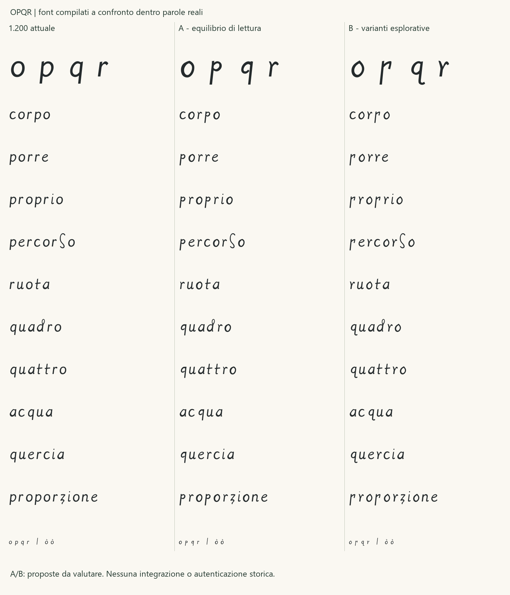

# Studio delle varianti o, p, q, r

**Esito successivo:** la [Regular 1.210](REGULAR_1_210.md) integra la
scelta umana **o B, p A, q B, r B**. Le sezioni seguenti conservano il
confronto preparatorio, le proposte e il parere precedente dell'agente;
la nuova ricevuta non riscrive gli stati dello studio originario.

15 ottobre 2026. Confronto richiesto fra la Regular 1.200 e due serie
di proposte contemporanee più attente ai tratti dei campioni selezionati.
È uno studio di disegno: il font 1.200 installato, le versioni precedenti,
le letture revisionate e le ricevute di approvazione restano invariati.
Le varianti A/B non hanno una nuova approvazione umana e non sono integrate.

## Materiale confrontato

Sono stati riesaminati tutti i **22 campioni revisionati** delle quattro
lettere nel registro: sei o, cinque p, cinque q e sei r, BNE Madrid I,
MSS/8937, folii 1r–4r. Per ogni campione sono stati verificati SHA256,
dimensioni dell'originale (1578 × 2174 pixel), ritaglio e contesto ampliato.
Le copie già acquisite sono state specchiate orizzontalmente e ingrandite,
senza ricostruzione, contrasto o alterazione degli originali. Le immagini
e i confronti con riproduzioni BNE rimangono locali, esclusi da Git.

Il [registro dello studio](../data/opqr_variant_study_2026-10-15.json)
riporta tutti gli ID, folii, hash, coordinate, osservazioni, esclusioni
e scelte di disegno. Il CSV storico conserva gli stessi byte: non sono
registrate nuove letture o conferme dei confini. I contesti lessicali
precedenti restano proposte dove non erano stati confermati integralmente.

## Osservazione e intervento

| Lettera | Tratto osservato | Serie A | Serie B e limite |
|---|---|---|---|
| o | Controforme oblique, chiusure appuntite e fianchi asimmetrici; variazioni fra 2r e 3r. | Ovale asimmetrico con vertice contenuto e controforma chiusa. | Punta e cambi di direzione più marcati; non è una misura del tratto storico. |
| p | P02/p03 hanno testa piccola e alta rispetto all'asta; p04 presenta una testa aperta a bandiera. | Testa chiusa ridotta e alzata; discendente relativamente più lunga. | Testa aperta basata su p04; maggiore rischio di lettura come r allungata. |
| q | Q01 ha testa ripiegata aperta e discendente destra; q02 offre una diversa variante con cappio e coda curva. | Apertura inferiore destra, testa più alta e discendente diritta. La curva sinistra è ampliata per leggibilità rispetto all'uncino breve di q01. | Testa chiusa e coda curva da q02; variante distinta, non forma generale delle q. |
| r | Attacco a forcella e spalla breve in più folii, invece di un'asta con arco regolare. | Forcella contenuta nella parte alta e asta più riconoscibile. | Biforcazione più profonda; maggiore rischio di lettura come v/y. |

Le ancore principali sono indicate per ogni lettera nel registro. P05,
p09, q03, q04 e q05 conservano le esclusioni geometriche motivate nella
[revisione delle segmentazioni](SEGMENTATION_CONSOLIDATED.md).
Il token di r04 resta irrisolto e non guida il disegno principale.
I raccordi con i vicini, il ponte della q e i terminali dubbi non sono
trasformati in tratti autonomi. La coda di q02 è trattata separatamente.

La lunghezza delle aste, il peso, le chiusure, l'apertura della q A e
la posizione dei raccordi sono interventi contemporanei. Le discendenti
restano entro le metriche della Regular: non riproducono integralmente
le lunghezze relative dei campioni. Le dimensioni ridotte degli originali
non permettono di ricostruire con certezza pressione o ordine dei tratti.

## Confronto nelle parole



Le parole **corpo, porre, proprio, percorso, ruota, quadro, quattro,
acqua, quercia, proporzione** sono esempi italiani per confrontare il
nuovo disegno. Non sono nuove trascrizioni certificate dei manoscritti.
La frase editabile iniziale è «Il corpo ruota; l'acqua scorre. Proporre
quattro percorsi.» Nella pagina locale si possono variare corpo e testo,
confrontare simultaneamente tre font e aprire le quattro tavole storiche.

La valutazione dell'agente favorisce **o A, p A, q A, r A** come base
di lavoro leggibile. La q B può essere valutata come alternativa di
disegno legata al campione q02. P B e r B sono confronti esplorativi:
la maggiore evidenza del gesto non risolve i rischi di lettura. Le scelte
possono essere miste, per singola lettera; non si approva una serie in blocco.

La prima r A aveva una biforcazione più bassa ed è stata corretta prima
della consegna: il raccordo è stato alzato per rendere più chiara l'asta.
Il disegno conservato negli SVG e nella tavola è quello corretto.

## Riproduzione e verifiche

```powershell
.\.venv\Scripts\python.exe examples/opqr_study.py --out build/opqr-study
```

Per aggiungere le tavole locali, indicare con `--originals` la cartella
delle immagini originali già acquisite; il generatore richiede gli hash
attesi. La compilazione e il confronto delle parole funzionano anche
senza immagini. Il percorso di output deve essere nuovo e sotto `build/`.
Non vengono scaricate riproduzioni. Servire la radice del progetto con
`python -m http.server 8765 --bind 127.0.0.1` e aprire
`/build/opqr-study/index.html`.

Le famiglie di studio sono **Leonardus OPQR A** e **Leonardus OPQR B**,
versione tecnica 1.201 con dicitura di studio non approvato. I TTF generati
rimangono in `build/`; non sostituiscono la famiglia installata. Le quattro
basi cambiano, ò segue il componente o e le ancore combinanti sono
ricalcolate. Tutti gli advance e gli altri contorni sono conservati.
Il repertorio resta di 119 codepoint e 121 glifi.

Sono state eseguite due compilazioni identiche per ciascuna variante,
audit, copertura e controllo di 2.704 coppie per serie, senza collisioni
di inchiostro nelle condizioni raster a 128 ppem e soglia 127. Le prove
HarfBuzz/FreeType a 12/18/36/72 pt, a 96 DPI, e la tavola delle parole
sono generate dai TTF compilati, senza fallback. Questo controllo non
certifica la leggibilità per ogni lettore, dimensione o applicazione.
La pagina locale verifica il caricamento dei tre font, il confronto
del testo digitato e l'avviso per i caratteri fuori repertorio.

La suite locale dello studio completa 143 test con esito positivo; cinque
controlli dei symlink sono saltati perché Windows non consente di crearli
nel contesto di esecuzione. Privacy e inventario sono verificati in un
checkout isolato, escludendo le modifiche PDF locali estranee allo studio.

La verifica tecnica preserva la 1.200, il registro storico e gli ambiti
delle approvazioni. Una scelta umana per lettera resta necessaria prima
di integrare eventuali varianti in una nuova candidata. Non sono eseguite
nuove prove Office, installazioni delle serie A/B o stampe fisiche.
