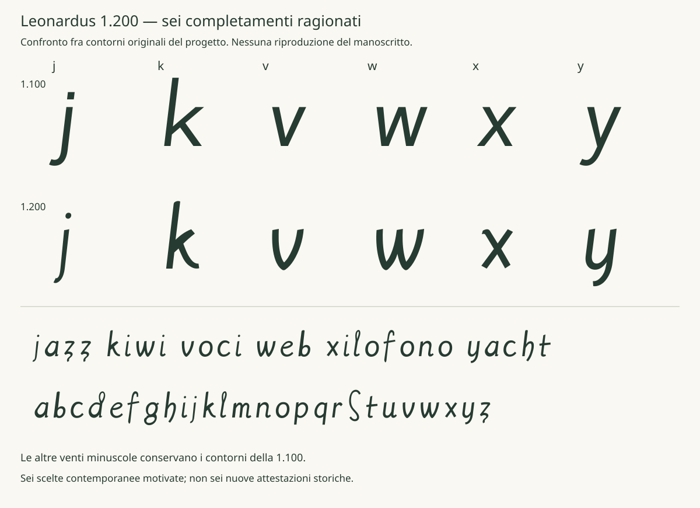

# Leonardus 1200 - Regular 1.200 da provare

Checkpoint conservato. La candidata successiva è la [Regular 1.210](REGULAR_1_210.md),
con la scelta o B, p A, q B, r B dallo studio OPQR. Le informazioni e
i limiti seguenti riguardano la versione 1.200.

15 ottobre 2026. Candidata contemporanea LTR con tutte le **26 minuscole
ragionate e documentate**, costruita conservando le venti forme approvate
della 1.100 e ridisegnando j, k, v, w, x, y. Il repertorio complessivo
resta di 119 codepoint e 121 glifi; maiuscole, cifre, accenti e altri
simboli conservano il disegno della 1.100.

Il font è [Leonardus-1200-Regular.ttf](../fonts/Leonardus-1200-Regular.ttf),
famiglia **Leonardus 1200**, stile **Regular**. Il nome distinto permette
il confronto con la famiglia Leonardus 1.100 senza sostituire il checkpoint.
OFL 1.1 resta la licenza dei contorni.

## Cosa è stato completato

- Tutti i 61 campioni segmentati hanno un esito motivato: 43 compatibili
  con riserve e 18 dubbi. Gli originali sono verificati per hash e dimensioni.
  I dubbi restano esclusi dalla geometria principale nelle zone descritte.
- Le 29 decisioni umane sui singoli campioni sono conservate; le altre 32
  sono valutazioni dell'agente su delega esplicita. Non sono nuove revisioni
  umane o attestazioni paleografiche.
- Le [26 schede](LOWERCASE_DERIVATION_1_200.md) e il
  [CSV per glifo](DERIVAZIONE_1_200.csv) distinguono motivo, fonte, disegno
  adottato e limiti. Le venti minuscole con letture storiche già revisionate
  restano venti: le sei nuove forme non aumentano quel conteggio.
- I quattro confronti supplementari per c/f/i/z sono valutati separatamente:
  c03 rimane ambigua; f05 e i17 sono confronti formali tecnici; z303 offre
  un confronto contestuale su un'altra pagina, con foliazione di lavoro
  ancora distinta dalla revisione umana. Il CSV storico conserva 144 righe,
  101 revisionate e 43 candidate.

Le [valutazioni di ricerca](../data/research_assessment_2026-10-15.json)
non trasformano etichette, maiuscole o segni tecnici in minuscole certe.

## Le sei forme rielaborate

| Lettera | Decisione di disegno e limite storico |
|---|---|
| j | Asta e punto coerenti con i; coda curva. L'etichetta nel cerchio a BNE 303 non distingue j da i lunga o indice. |
| k | Ascendente della famiglia h e bracci curvi; confronto con K dei diagrammi, senza attestare una k minuscola. |
| v | Ritorno curvo confrontato con le forme arrotondate v/u/o di BNE 49; valle e distinzione dalla u sono moderne. |
| w | Doppio ritmo costruito da u e dalla nuova v; nessun campione diretto selezionato. |
| x | Incrocio asimmetrico confrontato con due riferimenti tecnici di BNE 49; scala e uscite progettate. |
| y | Corpo della famiglia u e discesa curva confrontata con h e candidata y/h di BNE 303; mappatura moderna dichiarata. |



Le nuove forme sono disegni originali dell'agente nell'ambito della
[delega](../data/completion_authorization_2026-10-15.json), con manifesti
e sorgenti separati. Non si dichiara una nuova ispezione umana di questi
contorni né un'approvazione della pubblicazione. La s già approvata resta
identica alla 1.100.

## Prova del font

Aprire la [pagina di prova](../specimen/Leonardus-1200-Trial.html) dalla
cartella completa del progetto. Scrivere nel riquadro, cambiare il corpo
fra 12 e 72 pt e confrontare 1.200 e 1.100. Il font viene caricato dal
TTF locale, senza servizi esterni. I caratteri fuori dal repertorio sono
segnalati. Se il browser blocca i font da file locale, dalla radice del
progetto avviare:

```powershell
.\.venv\Scripts\python.exe -m http.server 8765 --bind 127.0.0.1
```

Aprire `http://127.0.0.1:8765/specimen/Leonardus-1200-Trial.html`.
Il [campionario PDF](../specimen/Leonardus-1200-Specimen.pdf) contiene
quattro pagine A4 a 12, 18, 36 e 72 pt reali; per una prova su carta usare
scala 100%, senza adattamento automatico.

Per Word o PowerPoint, installare il TTF nell'account utente e scegliere
**Leonardus 1200 / Regular**. Le prove native della 1.100 restano un record
distinto: non sono una verifica applicativa della 1.200.

## Verifiche e livello di completamento

La compilazione conserva cmap, venti minuscole approvate, maiuscole e
compositi; soltanto sei contorni e i rispettivi advance cambiano.
Le ancore degli accenti combinanti sono ricalcolate sulle nuove basi.
I test verificano riproducibilità, conservazione del checkpoint e
attribuzione corretta dei pareri. Audit, copertura, 2.704 coppie a 128 ppem
e campionari raster/PDF fanno parte della verifica della candidata.

L'analisi progettuale delle 26 minuscole e il consolidamento dei 61 ID
sono conclusi per questa consegna. Una verifica paleografica indipendente,
una stampa fisica, la prova umana del nuovo disegno e le prove native
Office 1.200 non sono state dichiarate eseguite. Questi limiti non sono
trasformati in attestazioni: la consegna è un font moderno completo e
motivato da provare, non 26 facsimili autenticati.

Il controllo della distribuzione pubblica resta separato. La 1.000 e
la 1.100 conservano gli stessi byte e gli stessi registri di approvazione.
