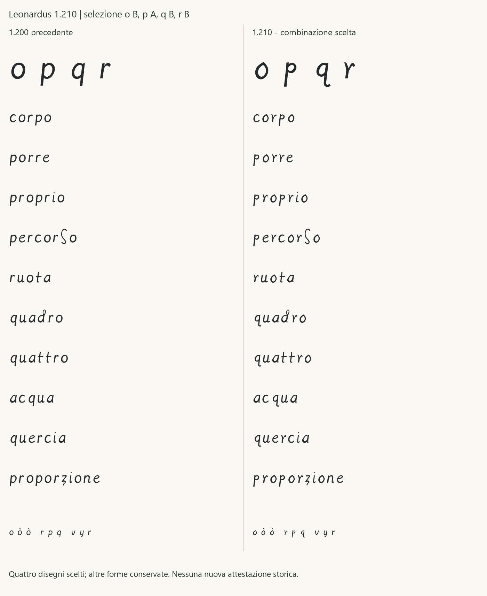

# Regular 1.210 - integrazione della scelta OPQR

Checkpoint conservato. La successiva [Regular 1.211](REGULAR_1_211.md)
riequilibra gli spazi laterali di p e q, mantenendo le forme scelte.
Le metriche e le verifiche seguenti riguardano la 1.210.

15 ottobre 2026. La nuova candidata integra **o B, p A, q B, r B**,
scelte nella revisione umana del confronto fra la 1.200 e le serie A/B.
Il TTF è [Leonardus-1210-Regular.ttf](../fonts/Leonardus-1210-Regular.ttf),
famiglia **Leonardus 1210**, stile **Regular**, versione 1.210. Il nome
distinto permette il confronto con Leonardus 1200 senza sostituirlo.

## Scelta e ambito

La [ricevuta](../data/human_opqr_integration_review_2026-10-15.json)
conserva la citazione della scelta e gli hash della tavola, dello studio,
dei quattro SVG e degli advance. Il [manifesto di integrazione](../glyphs/regular/release-1.210.json)
collega esattamente la selezione B/A/B/B alla compilazione. Il precedente
studio resta un record delle proposte, con i propri stati e file invariati.
I titoli storici negli SVG sono conservati; la nuova ricevuta registra
la scelta dei quattro sorgenti mostrati.

Questa decisione approva l'uso dei quattro disegni selezionati. Non
riapprova letture, segmentazioni, autenticità, tutte le altre 22 minuscole
o diffusione pubblica. Il registro storico resta di 144 campioni,
101 revisionati e 43 candidati. Le minuscole con riferimenti a letture
revisionate restano **20**, con sei completamenti contemporanei ragionati.

La classificazione corrente distingue cinque normalizzazioni del pilota
conservate (a, d, e, l, n), quindici disegni approvati con riferimenti
revisionati (b, c, f, g, h, i, m, o, p, q, r, s, t, u, z) e sei
completamenti ragionati (j, k, v, w, x, y). O e r passano dalla
normalizzazione precedente ai nuovi disegni selezionati; non aumenta
il numero di lettere storicamente documentate.

## Forme integrate

| Lettera | Disegno scelto | Rapporto con i campioni e limite |
|---|---|---|
| o | B | Vertice superiore più evidente, controforma obliqua e fianchi asimmetrici, confrontati con le o di 2r/3r. Punta, peso e chiusura sono progettati. |
| p | A | Testa chiusa più piccola e alta rispetto all'asta, sulla base di p02/p03; discendente contenuta nelle metriche del font. P05/p09 non guidano gli estremi. |
| q | B | Testa chiusa alta e coda curva come interpretazione distinta di q02, folio 1r; non è dichiarata una forma generale di tutte le q. |
| r | B | Forcella più profonda e ramo sinistro alto, confrontati con più folii. La scelta conserva il maggiore rischio di lettura come v/y già mostrato nello studio. |

Le motivazioni e le esclusioni del [confronto storico](OPQR_VARIANT_STUDY.md)
restano valide. Il [CSV per tutti i glifi](DERIVAZIONE_1_210.csv) aggiorna
le quattro schede, le ancore rappresentative e la dipendenza tecnica ò;
le schede della 1.200 descrivono ancora le altre 22 minuscole invariate.

## Dipendenze e verifica

Cambiano quattro basi semplici. Il composito **ò** riutilizza la nuova
o e riallinea il grave alle ancore della base: offset [258, 439], invece
di [254, 426]. Il suo sidebearing segue quello della o. Le ancore degli
accenti combinanti sono ricalcolate. Tutti gli advance restano invariati;
gli altri contorni e componenti mantengono la 1.200. I checkpoint 1.000,
1.100 e 1.200 conservano i propri byte.

Il repertorio resta di 119 codepoint e 121 glifi. Le prove verificano la
corrispondenza esatta ai quattro SVG scelti, riproducibilità, conservazione
delle altre forme e degli advance, accenti, limiti di approvazione e
rifiuto della sovrascrittura dei checkpoint. Audit, copertura, confronto
di 2.704 coppie a 128 ppem e campionari a 12/18/36/72 pt completano la
verifica tecnica. [QA_1_210.json](QA_1_210.json) conserva gli esiti effettivi.

SHA256 del TTF:
`c10aad78edd64c9ba5ac21fc68369f824e97aa6e21b2b895e288156c044d3ef8`.

## Usare la versione

Aprire la [pagina di prova](../specimen/Leonardus-1210-Trial.html) dalla
cartella completa, oppure servirla con `python -m http.server 8765 --bind 127.0.0.1`
e aprire `/specimen/Leonardus-1210-Trial.html`. La pagina permette il
confronto con la 1.200 e segnala i caratteri fuori repertorio.

Installare il TTF nell'account Windows e selezionare **Leonardus 1210**.
La verifica GDI restituisce gli stessi byte del TTF incluso; questo
attesta la selezione Windows, non una nuova prova Word/PowerPoint.
Le prove native Office della 1.210, la stampa fisica e una verifica
paleografica indipendente non sono dichiarate eseguite. La licenza dei
contorni resta OFL 1.1; le immagini dei manoscritti restano escluse da Git.
