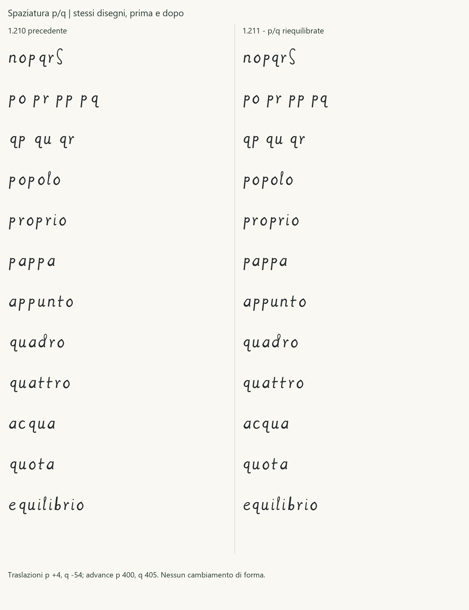

# Regular 1.211 - riequilibrio degli spazi di p e q

Checkpoint conservato. La successiva [Regular 1.220](REGULAR_1_220.md)
integra a A, e A, m B, n B e u B, mantenendo la spaziatura p/q qui
documentata. Le verifiche seguenti riguardano la 1.211.

La 1.211 corregge il bianco eccessivo fra p e q e controlla le altre
coppie coinvolte, conservando le forme scelte **o B, p A, q B, r B**.
Il TTF è [Leonardus-1211-Regular.ttf](../fonts/Leonardus-1211-Regular.ttf),
famiglia **Leonardus 1211**, stile Regular. Il [manifesto](../glyphs/regular/release-1.211.json)
registra l'istruzione ricevuta, le metriche precedenti e quelle corrette.
Non è una nuova approvazione umana del disegno o delle fonti storiche.

## Intervento

| Lettera | Advance prima → dopo | Margine sinistro prima → dopo | Margine destro prima → dopo | Traslazione |
|---|---|---|---|---|
| p | 440 → 400 | 51 → 55 | 99 → 55 | +4 |
| q | 450 → 405 | 114 → 60 | 7 → 16 | −54 |

Le unità sono millesimi di em. Il margine destro globale della q include
la coda curva sotto la linea di base: non misura da solo il bianco
ottico del corpo. Il corpo della q conserva uno spazio destro più ampio
di quello indicato dall'estremo della coda.

Cambiano soltanto origine orizzontale e advance di p/q. Le coordinate
relative dei punti, i tipi di punto, le curve, la chiusura, il numero
dei contorni e i limiti verticali sono identici. Non viene ridisegnato
o scalato alcun glifo; gli SVG scelti conservano gli stessi byte.
Le ancore degli accenti combinanti seguono le traslazioni. Tutti gli
altri contorni, componenti e advance sono invariati rispetto alla 1.210.
Non si aggiunge kerning specifico per la coppia pq.

## Confronto delle coppie e delle parole

| Coppia | Distanza fra estremi prima | Distanza dopo |
|---|---|---|
| no | 123 | 123 |
| op | 110 | 114 |
| pq | 213 | 115 |
| po | 167 | 123 |
| pr | 169 | 125 |
| pp | 150 | 110 |

Il diagnostico locale include anche qr, qu, qp, aq e qq, distinguendo
gli estremi globali da una proiezione del corpo fra baseline e y=400.
Le misure accompagnano il confronto visivo, senza trasformarsi in una
certificazione di uniformità ottica. Per esempio, la proiezione del
corpo di qu passa da circa 138 a 147 unità e quella di qr da 134 a 143:
la riduzione della spaziatura in entrata non stringe il corpo in uscita.

Sono state confrontate due ipotesi metriche e scelta quella bilanciata
dopo l'ispezione di «popolo», «proprio», «pappa», «appunto», «quadro»,
«quattro», «acqua», «quota» ed «equilibrio», oltre alle sequenze di coppie.
Le prove a 12/18/36/72 pt verificano anche la lettura ai corpi piccoli.



## Verifica e uso

Il repertorio resta di 119 codepoint e 121 glifi. Il test geometrico
riporta i punti di p e q all'origine precedente e verifica l'uguaglianza
esatta delle coordinate; confronta inoltre tutti gli altri glifi e le
loro metriche. Altri test verificano riproducibilità, ancore, ambito
dell'intervento e protezione dei checkpoint. Gli esiti sono nel
[rapporto QA](QA_1_211.json).

Il controllo raster copre tutte le 2.704 coppie delle 52 lettere di base
a **16, 24, 48, 96 e 128 ppem**, con soglia dell'inchiostro 127: zero
collisioni nelle condizioni dichiarate. I primi quattro valori corrispondono
a 12/18/36/72 pt a 96 DPI. Il controllo delle collisioni è distinto
dall'ispezione ottica delle parole.

SHA256: `75e11eb8b0cfe807c37c17900b68726c4865e3d76e91d92656aa203d568d8482`.
La licenza resta OFL 1.1. Le precedenti versioni sono checkpoint invariati;
il registro storico e le classificazioni delle 26 minuscole non cambiano.

Aprire la [pagina di prova](../specimen/Leonardus-1211-Trial.html), oppure
servire la radice con `python -m http.server 8765 --bind 127.0.0.1` e
aprire `/specimen/Leonardus-1211-Trial.html`. Il selettore confronta 1.211
e 1.210 sullo stesso testo. In Windows scegliere **Leonardus 1211**.
La selezione GDI è verificata per byte; le prove native Word/PowerPoint
di questa versione e la stampa fisica non sono dichiarate eseguite.

Per ricompilare e riprodurre i confronti:

```powershell
python -m leonardus.cli build-release --version 1.211 --out build/Leonardus-1211-Regular.ttf
python -m leonardus.cli audit --font build/Leonardus-1211-Regular.ttf
python -m leonardus.cli charset --font build/Leonardus-1211-Regular.ttf
python examples/regular_spacing_check.py --font build/Leonardus-1211-Regular.ttf --ppem 128 --out build/pairs-1211.json
python examples/regular_specimen.py --font build/Leonardus-1211-Regular.ttf --out build/proof-1211 --candidate
python examples/pq_spacing_proof.py --out build/pq-spacing-proof
```
