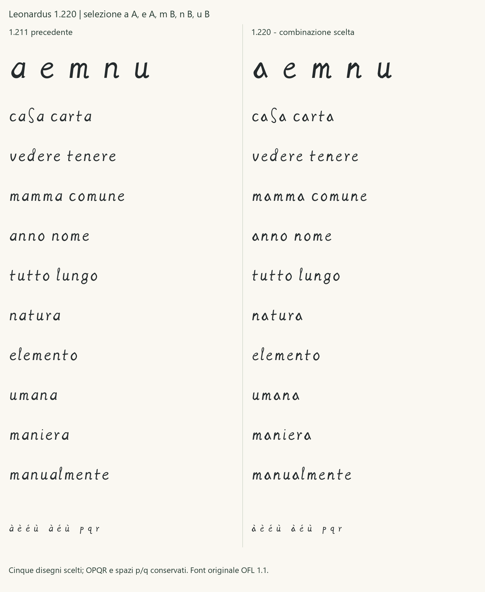

# Regular 1.220 - integrazione della scelta AEMNU

15 ottobre 2026. La candidata integra **a A, e A, m B, n B, u B**,
scelte esplicitamente nella revisione del confronto con la 1.211.
Il TTF è [Leonardus-1220-Regular.ttf](../fonts/Leonardus-1220-Regular.ttf),
famiglia **Leonardus 1220**, stile Regular, versione 1.220.
La [ricevuta umana](../data/human_aemnu_integration_review_2026-10-15.json)
conserva la citazione della scelta e gli hash dello studio, della tavola,
dei cinque SVG e degli advance. Il [manifesto di integrazione](../glyphs/regular/release-1.220.json)
vincola questi sorgenti alla compilazione.

## Forme e ambito

| Lettera | Scelta | Forma adottata |
|---|---|---|
| a | A | Corpo triangolare a capanna, con controforma e chiusura inferiore progettate per riconoscibilità. |
| e | A | Occhio piccolo e alto, corpo continuo e uscita distesa; la continuità è una scelta contemporanea. |
| m | B | Spalle a cuspide diseguali e raccordi diagonali. |
| n | B | Spalla a tetto con cambi di direzione più netti. |
| u | B | Fondo angoloso e risalita tesa, conservando il raccordo basso. |

Sono esattamente i cinque contorni mostrati nello [studio AEMNU](AEMNU_VARIANT_STUDY.md),
senza ulteriori modifiche di forma o advance. La scelta riguarda questi
disegni e la loro integrazione, non nuove letture, segmentazioni,
autenticità, tutte le altre 21 minuscole o pubblicazione.
Le forme o B, p A, q B, r B e le metriche p/q della 1.211 restano identiche.

Le 27 localizzazioni BNE confrontate, le esclusioni m08/u08 e i limiti
delle immagini restano quelli documentati nello studio. Non sono stati
acquisiti nuovi campioni ad alta risoluzione, né usate immagini Arundel.
Il registro storico conserva 144 campioni, 101 revisionati e 43 candidati.
Le minuscole con riferimenti a letture revisionate restano **20**, con
sei completamenti contemporanei ragionati.

La classificazione corrente comprende due normalizzazioni conservate
(d, l), diciotto disegni approvati con riferimenti revisionati
(a, b, c, e, f, g, h, i, m, n, o, p, q, r, s, t, u, z), e sei
completamenti ragionati (j, k, v, w, x, y). A/e/n passano dai sorgenti
normalizzati del pilota ai nuovi disegni scelti; non aumenta il numero
di lettere con riferimenti storici. Il [CSV aggiornato](DERIVAZIONE_1_220.csv)
riporta tutte le forme e le dipendenze.

## Accenti e verifica

Cambiano cinque basi semplici. I compositi **à, è, é, ù** riutilizzano le
nuove basi e riallineano gli accenti alle stesse ancore delle sequenze
scomposte. Gli advance di tutti i glifi restano invariati. Gli altri
contorni, componenti e margini laterali sono conservati, comprese o/p/q/r.
I checkpoint 1.000, 1.100, 1.200, 1.210 e 1.211 mantengono gli stessi byte.

Il repertorio resta di 119 codepoint e 121 glifi. I test verificano
corrispondenza ai cinque SVG scelti, due build identiche, conservazione
delle altre forme e degli advance, ancore, equivalenza NFC/NFD e ambito
della revisione. Audit, copertura e tutte le 2.704 coppie delle 52 lettere
a 16/24/48/96/128 ppem completano il controllo tecnico: nessuna collisione
nelle condizioni raster dichiarate, soglia 127. Le prove delle parole
sono distinte dal controllo delle collisioni. Il [rapporto QA](QA_1_220.json)
conserva gli esiti effettivi.



SHA256 del TTF: `57d0a07912297b0d52f2eb0ecbc6ee0b70bbc55d10e9db0ed85f74c275c06783`.

## Prova e installazione

Aprire la [pagina 1.220](../specimen/Leonardus-1220-Trial.html), che confronta
la versione corrente con la 1.211 sullo stesso testo. Servire la radice
con `python -m http.server 8765 --bind 127.0.0.1` e aprire
`/specimen/Leonardus-1220-Trial.html`.

In Windows scegliere **Leonardus 1220**. L'installazione nell'account
corrente e la selezione GDI sono verificate per byte; le altre famiglie
sono conservate. Non sono dichiarate eseguite nuove prove native in
Word/PowerPoint o una stampa fisica. I contorni restano OFL 1.1.

Per riprodurre la candidata:

```powershell
python -m leonardus.cli build-release --version 1.220 --out build/Leonardus-1220-Regular.ttf
python -m leonardus.cli audit --font build/Leonardus-1220-Regular.ttf
python -m leonardus.cli charset --font build/Leonardus-1220-Regular.ttf
python examples/regular_spacing_check.py --font build/Leonardus-1220-Regular.ttf --ppem 128 --out build/pairs-1220.json
python examples/regular_specimen.py --font build/Leonardus-1220-Regular.ttf --out build/proof-1220 --candidate
python examples/aemnu_selection_proof.py --out build/aemnu-selection.png
```
