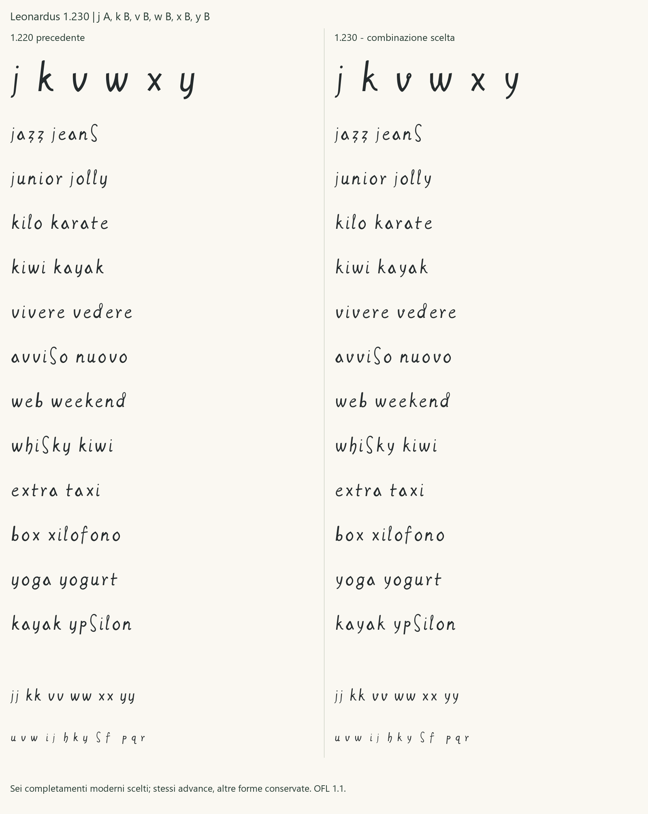

# Regular 1.230 - integrazione della scelta JKVWXY

16 ottobre 2026. La candidata integra **j A, k B, v B, w B, x B, y B**,
scelte esplicitamente dopo il confronto con la 1.220. La lista della
revisione umana prevale sul precedente suggerimento dell'agente per v A:
la forma adottata è **v B con l'anello**.

Il TTF è [Leonardus-1230-Regular.ttf](../fonts/Leonardus-1230-Regular.ttf),
famiglia **Leonardus 1230**, stile Regular, versione 1.230. La
[ricevuta umana](../data/human_jkvwxy_integration_review_2026-10-16.json)
conserva citazione, scelte e hash della tavola e dei sei SVG. Il
[manifesto](../glyphs/regular/release-1.230.json) li vincola alla build.
Lo [studio JKVWXY](JKVWXY_VARIANT_STUDY.md) resta il checkpoint preparatorio.

## Forme e ambito

| Lettera | Scelta | Forma adottata |
|---|---|---|
| j | A | Coda più continua e aperta, punto e asta della i conservati. |
| k | B | Braccio superiore compatto e gamba che nasce da una spalla curva. |
| v | B | Piccolo ritorno ovale sul braccio destro, rialzato per mantenere leggibile la valle. |
| w | B | Doppio ritmo spezzato coordinato con m B, n B e u B. |
| x | B | Direzioni curve diseguali, incrocio più alto e uscita inferiore gestuale. |
| y | B | Forcella curva alta e discesa obliqua aperta. |

Sono esattamente i sei contorni mostrati nello studio. L'approvazione
riguarda i disegni e la loro integrazione e installazione, senza nuove
letture, segmentazioni o attestazioni di autenticità. Non approva
nuovamente le altre venti minuscole né la pubblicazione del progetto.

Le sei forme restano **completamenti contemporanei ragionati** anche
dopo la selezione umana. Le sei localizzazioni candidate j/v/x/y e i
tre contesti K mantengono le riserve; le K non diventano attestazioni
di k minuscola. W rimane una sintesi senza campione diretto selezionato.
Le nuove piste e-Leo non sono geometrie primarie. Posizione dell'anello
di v e forcella di y sono scelte moderne dichiarate.

Il registro storico conserva gli stessi byte: **144 campioni, 101
revisionati e 43 candidati**. Restano venti minuscole collegate a letture
revisionate e sei completamenti. La classificazione è ancora 2
normalizzazioni, 18 disegni con riferimenti revisionati, 6 completamenti.
Le 61 segmentazioni consolidate non cambiano. Il
[CSV per glifo](DERIVAZIONE_1_230.csv) aggiorna i sorgenti dei soli sei
completamenti, mantenendo distinte le letture revisionate dai confronti
candidati e dalle sintesi.

## Spaziatura e verifiche

La nuova combinazione è confrontata con la 1.220 in dodici coppie di
parole, comprese «vivere vedere», «avviso nuovo», «kiwi kayak»,
«web weekend», «whisky kiwi», «extra taxi», «yoga yogurt» e nelle doppie
jj/kk/vv/ww/xx/yy. Sono prodotte prove a 12/18/36/72 pt, 96 DPI,
con HarfBuzz e FreeType senza fallback. La valutazione visiva non
individua un eccesso di bianco tale da richiedere nuove metriche:
**gli advance sono conservati**, senza introdurre kerning specifico.
I margini laterali dei sei glifi riflettono i nuovi contorni.

| Lettera | Advance | Margine sinistro | Margine destro |
|---|---:|---:|---:|
| j | 240 | 10 | 69 |
| k | 430 | 78 | 52 |
| v | 430 | 87 | 48 |
| w | 570 | 81 | 59 |
| x | 415 | 76 | 68 |
| y | 410 | 91 | 58 |

Le misure sono bounding box globali in unità su 1000, non la distanza
ottica lungo ogni rigo. Il piccolo anello di v B perde dettaglio ai
corpi piccoli: è un limite di resa, non una nuova prova storica.
Le forme scelte sono conservate anche in quella condizione.

Audit e copertura verificano **119 codepoint e 121 glifi**. Tutte le
2.704 coppie delle 52 lettere, a 16/24/48/96/128 ppem e soglia raster
127, sono prive di collisioni nelle condizioni verificate. I test
controllano due build identiche, corrispondenza ai sei SVG, conservazione
degli altri contorni e di tutti gli advance, ancore combinanti, NFC/NFD
degli accenti italiani e rifiuto di selezioni o classificazioni alterate.
Il [rapporto QA](QA_1_230.json) conserva gli esiti effettivi.



Le forme AEMNU, le forme OPQR, i compositi accentati e il riequilibrio
p/q sono conservati. Il bianco bbox p–q resta 115 unità. Le ancore
combinanti seguono i nuovi sei corpi; i checkpoint 1.000, 1.100, 1.200,
1.210, 1.211 e 1.220 mantengono gli stessi byte.

SHA256 del TTF: `d8431dde57bb1f7427d73003b60f3590c2845f3bd311d70bb7da3a5d9b8e30c5`.

## Prova e installazione

Aprire la [pagina 1.230](../specimen/Leonardus-1230-Trial.html), con
testo modificabile, alfabeto e confronto con la 1.220. Servire la radice
con `python -m http.server 8765 --bind 127.0.0.1` e aprire
`/specimen/Leonardus-1230-Trial.html`.

In Windows scegliere **Leonardus 1230**, stile Regular. L'installazione
nell'account corrente, la registrazione e la selezione GDI sono
verificate; i byte selezionati coincidono con il TTF, anche da un nuovo
processo. La 1.220 registrata è ricaricata nella sessione senza modificarne
file o registrazione. Non sono dichiarate prove native Word/PowerPoint
della 1.230 o stampa fisica. Font e contorni restano OFL 1.1.

Per riprodurre la candidata:

```powershell
python -m leonardus.cli build-release --version 1.230 --out build/Leonardus-1230-Regular.ttf
python -m leonardus.cli audit --font build/Leonardus-1230-Regular.ttf
python -m leonardus.cli charset --font build/Leonardus-1230-Regular.ttf
python examples/regular_spacing_check.py --font build/Leonardus-1230-Regular.ttf --ppem 128 --out build/pairs-1230.json
python examples/regular_specimen.py --font build/Leonardus-1230-Regular.ttf --out build/proof-1230 --candidate
python examples/jkvwxy_selection_proof.py --out build/jkvwxy-selection.png
```
