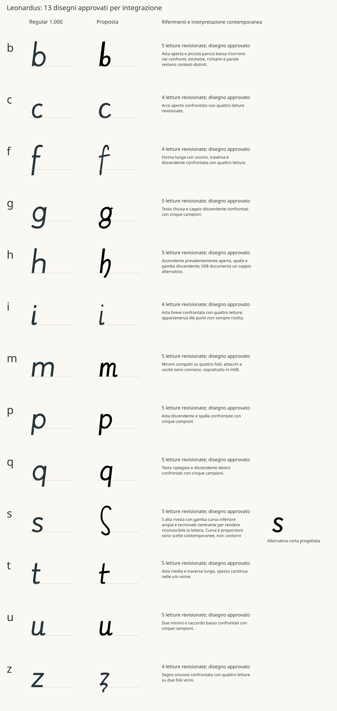
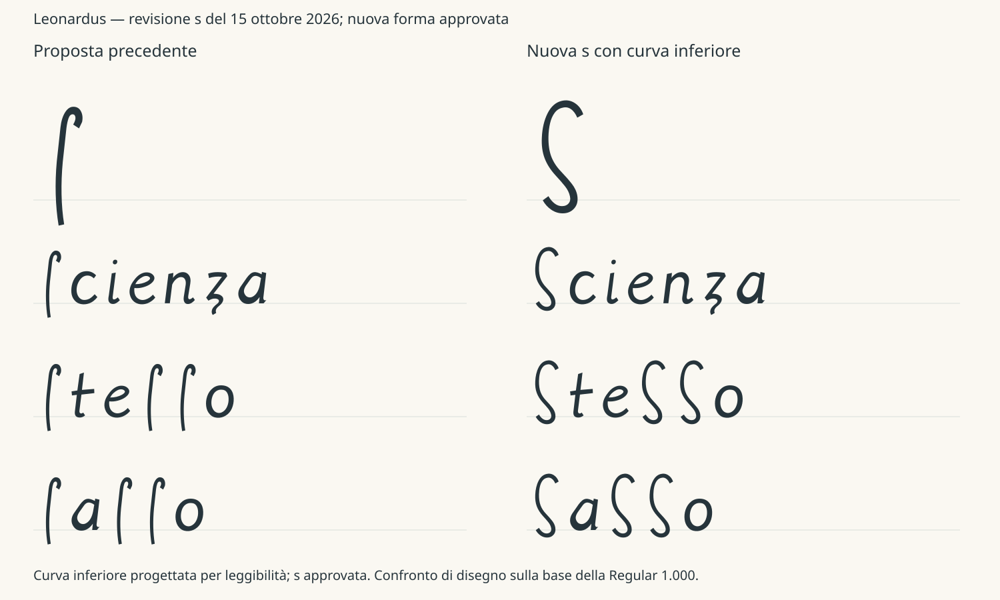

# Segmentazioni e nuove minuscole — proposte del 15 ottobre 2026

**Stato corrente:** tutte le 61 proposte hanno una valutazione separata
dei confini: 29 decisioni umane individuali e 32 pareri dell'agente su
delega; 43 compatibili con riserve e 18 dubbi. Il
[consolidamento completo](SEGMENTATION_CONSOLIDATED.md) conserva motivi e
attribuzione, senza promuovere i dubbi. Gli originali sono tutti verificati.
La [1.200](REGULAR_1_200.md) conserva i tredici disegni approvati qui
descritti e rielabora soltanto i sei completamenti j/k/v/w/x/y.

Il paragrafo seguente conserva lo stato del checkpoint di revisione s/f.

Il [piano di consolidamento e qualità](QUALITY_COMPLETION_PLAN.md)
avvia la revisione separata dei confini: sono registrati gli esiti delle
cinque m, cinque t, cinque p, cinque g, quattro f e cinque s, incluse
undici nuove versioni dei crop. Ventidue proposte sono compatibili con
riserve; m08, p05, p09, f03, s01, s05 e s06 restano dubbie, per p09 e s01
soprattutto nella delimitazione inferiore. Restano 32 ID senza una nuova
decisione sui confini. Il disegno della s nella Regular 1.100 è già
approvato; le nuove decisioni riguardano i ritagli storici e non riaprono
il disegno. Le annotazioni originali e i disegni approvati sotto
rimangono il checkpoint invariato; le nuove proposte sono versionate
separatamente e non modificano il font.

Sono preparate **61 segmentazioni manuali proposte**, tredici disegni
principali e un'alternativa corta di s. Lettura, foliazione e caso dei
61 campioni sono già revisionati. **Sono approvati e integrati nella
[Regular 1.100](REGULAR_1_100.md) tutti i tredici disegni:** b, c, f, g, h,
i, m, p, q, s, t, u, z. La s include la curva inferiore approvata nella
seconda revisione. La revisione dei confini dei 61 campioni è in corso,
con gli esiti separati indicati sopra.
La Regular 1.000 e le sue ricevute sono conservate come checkpoint.
Non è una ricostruzione autenticata della grafia.

Il [confronto vettoriale](../specimen/Lowercase-Proposals-2026-10-15.svg)
mostra la forma della Regular a sinistra e la nuova proposta al centro.
Contiene soltanto vettori originali del progetto, senza riproduzioni
del manoscritto, ed è consultabile direttamente su GitHub.



## Decisione sui disegni e revisione della s

La [prima ricevuta di disegno](../data/human_lowercase_design_review_2026-10-15.json)
registra dodici scelte della colonna Proposta e rimane invariata.
La [successiva ricevuta di integrazione](../data/human_lowercase_integration_review_2026-10-15.json)
registra l’approvazione della nuova s e l’integrazione dei tredici disegni,
vincolando SVG e advance. Le conferme riguardano i disegni contemporanei,
non le delimitazioni storiche o la diffusione pubblica. I titoli iniziali
negli SVG conservano lo stato della preparazione: lo stato corrente è
registrato nei manifesti e nelle ricevute.

Per s il confronto ha evidenziato una curva inferiore insufficiente e
scarsa riconoscibilità. La revisione conserva lo sviluppo alto e aggiunge
una gamba inferiore ampia, con terminale rientrante. La curva è progettata
per leggibilità: non è attribuita ai cinque campioni come tratto attestato.
L'advance passa da 380 a 440; la discesa compilata da 167 a 87 unità.
La proposta precedente è conservata in `s-long-v1.svg`; l'alternativa
corta `s-short.svg` resta non selezionata.

Il [confronto dedicato](../specimen/S-Revision-2026-10-15.svg) mostra
prima e dopo e le parole scienza, stesso e sasso. È generato dai contorni
dello studio compilato con shaping, senza font di ripiego.



## Cosa è stato separato

Ogni campione ha una nota individuale e coordinate locali al ritaglio
specchiato originale, a scala 1×. Le annotazioni distinguono:

- **Verde:** regione proposta come corpo della lettera.
- **Rosso:** tratti vicini o elementi tecnici proposti per l'esclusione.
- **Arancio:** confini e raccordi ancora incerti.
- **Blu:** linee di taglio proposte, da valutare nel contesto.

Queste regioni sono ipotesi manuali di separazione, non contorni storici
certificati. La vista isolata conserva i pixel originali nella regione
mantenuta, compresa la carta; rende trasparente il resto, senza
binarizzazione, ricostruzione dell'inchiostro o completamento di tratti
mancanti. Non è un SVG ottenuto automaticamente dal manoscritto.
Le aree incerte rimangono visibili nell'annotazione e richiedono una scelta.
I tagli blu sono indicazioni, non rimozioni automatiche dell'inchiostro.

Il [manifesto delle proposte](../data/lowercase_design_2026-10-15.json)
fissa con SHA256 il piano, il CSV, le annotazioni e tutti gli SVG. Le
tre raccolte coprono [b/h/m/t](../data/segmentation/bhmt-2026-10-15.json),
[g/p/q/s/u](../data/segmentation/gpqsu-2026-10-15.json) e
[c/f/i/z](../data/segmentation/cfiz-2026-10-15.json).
Ogni ID risale a folio, pagina BNE, immagine, hash, coordinate e ricevuta
di lettura. Il corpus conserva 101 revisioni e 43 candidate; nessuno stato
è modificato da queste proposte.

## Disegni e scelte da revisionare

Gli SVG sono disegnati indipendentemente, senza ricalco automatico o uso
di font esterni. Griglia 1000×1000, baseline y=800, contorni pieni chiusi,
senza stroke. Proporzioni, peso, terminali e collegamenti sono scelte
contemporanee, dichiarate per lettera nel manifesto.

| Lettera | Campioni | Advance integrato | Scelta principale e limiti del riferimento storico |
|---|---:|---:|---|
| b | 5 | 410 | Pancia piccola e bassa; distinguere parole e richiami tecnici. |
| c | 4 | 420 | Arco aperto e terminali regolari; supporto ancora limitato. |
| f | 4 | 390 | Uncino, traversa e discendente; separare gli ascendenti di f03. |
| g | 5 | 450 | Testa e cappio inferiore; orecchio progettato, distinguere g da 8. |
| h | 5 | 420 | Ascendente aperta e coda sotto baseline; variante a cappio h08 distinta. |
| i | 4 | 250 | Punto moderno progettato; non attribuirlo ai campioni come tratto certo. |
| m | 5 | 580 | Tre minimi compatti; confini m08 particolarmente incerti. |
| p | 5 | 440 | Lobo chiuso e discendente; diagonale tecnica p05 esclusa. |
| q | 5 | 450 | Testa chiusa e coda retta progettate; non generalizzare q02. |
| s rivista | 5 | 440 | Curva inferiore e terminale rientrante progettati per leggibilità, approvati e integrati. |
| s corta | stessi 5 riferimenti | 390 | Alternativa contemporanea: corpo corto e curva inferiore non attestati dai campioni lunghi. |
| t | 5 | 380 | Traversa autonoma dalle u/o; valutare larghezza nel testo. |
| u | 5 | 450 | Due minimi e raccordo basso; confini n/u/v e raccordi da verificare. |
| z | 4 | 385 | Diagonale leggibile e coda sinuosa; distinguere z da 3 e ampliare i contesti. |

c, f, i e z hanno quattro campioni revisionati ciascuna e rimangono
disegni con supporto documentale limitato, anche dopo l'approvazione visuale.
Cinque letture non certificano comunque la segmentazione o l'autenticità
del disegno. Nessuna classificazione
dei completamenti della Regular viene cambiata.

## Aprire il dossier locale

Gli originali sono quelli già acquisiti per i due batch; non ci sono
nuovi download. Le immagini BNE e i ritagli restano ignorati da Git.
Acquisizione e diritti sono descritti nel [primo batch](CORPUS_EXPANSION.md),
nel [secondo](LOWERCASE_SEARCH.md) e nella [verifica dei diritti](SOURCE_RIGHTS_REVIEW.md).

```powershell
.\.venv\Scripts\python.exe examples/segmentation_review.py --check-only
.\.venv\Scripts\python.exe examples/segmentation_review.py
```

Aprire `build/segmentation-review/index.html`. Il dossier contiene
61 schede e 244 immagini: bersaglio, annotazione, regione mantenuta e
contesto con bersaglio delimitato. Le tre viste del ritaglio sono 4×;
il contesto è 1:1. I colori sono sovrapposizioni dichiarate; gli originali
restano invariati. Credito: Imágenes procedentes de los fondos de la
Biblioteca Nacional de España; MSS/8937; CC BY 4.0 o equivalente;
ritaglio, specchiatura, isolamento e annotazioni dichiarati, nessun avallo BNE.

La pagina compone anche parole con due TTF di studio, uno con la s
rivista e uno con l'alternativa corta non selezionata. Hanno famiglie
diverse dalla Regular e sono generati soltanto in
`build/segmentation-review/`, senza installazione o rilascio.
Le altre lettere e le tabelle di shaping dello studio provengono dalla
1.000. Questo dossier conserva il confronto di disegno; il font
distribuito è la 1.100, con i senza punto, ì/ù e ancore aggiornate e
verificate nella [scheda di integrazione](REGULAR_1_100.md).

## Come comunicare la revisione

Le scelte dei tredici disegni e l’integrazione sono registrate e non
richiedono di essere ripetute. Rimane separata la **segmentazione**:
regione e tagli compatibili, oppure ID del campione e correzione
necessaria. Un dubbio su un raccordo può restare aperto. Questa revisione
serve alla documentazione storica e non blocca l’uso dei disegni
contemporanei già approvati.

Esempio di annotazione: «m08: rivedere il confine sinistro».
Si possono raccogliere le osservazioni direttamente
per lettera; non serve ripetere la revisione delle letture già registrate.
Il dossier non importa decisioni e non modifica automaticamente il font.
L’integrazione nella 1.100 comprende verifiche dei contorni, metriche,
ancore, versione e prove di compilazione e resa.

## Verifiche riproducibili

Il validatore controlla la copertura esatta dei 61 ID, ricevute e hash,
limiti delle annotazioni, contorni chiusi, bounds e margini degli SVG,
e la corrispondenza fra stati di revisione e ricevute dei tredici disegni.
Rifiuta modifiche ai disegni approvati anche se l’hash del manifesto viene
aggiornato, o promozioni delle segmentazioni prive di conferma.
Le prove TTF hanno nomi distinti e build ripetibili; il percorso di output
è vincolato alla cartella ignorata.
La CI verifica metadati e vettori senza immagini del manoscritto e continua
a ricompilare la Regular 1.100 e il checkpoint 1.000 con i rispettivi SHA256.
